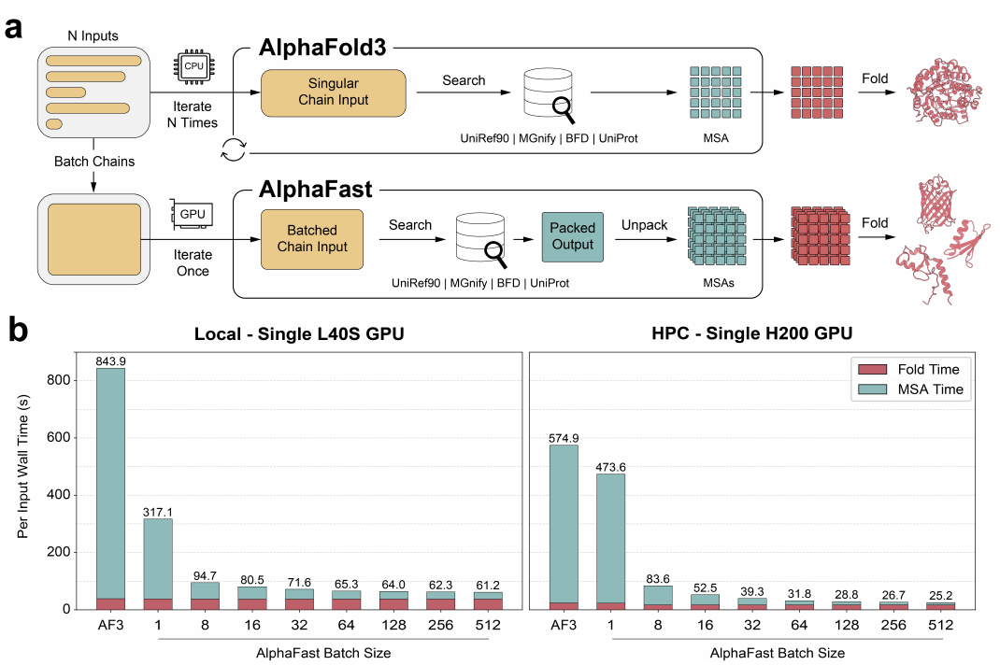

---
{
  "title": "AlphaFast: give the agent room to verify more candidates",
  "slug": "alphafast-verification-budget",
  "category": "Paper notes",
  "summary": "Faster batched structural evaluation changes the design strategies an agent can afford.",
  "paper": "alphafast",
  "draft": false
}
---

An agent may be able to generate many protein candidates but afford to examine only a few. In that setting, evaluation throughput becomes part of the agent's effective research budget.

## Accelerate the expensive repeated step

In my co-first-author work on AlphaFast, we replaced CPU-bound MSA construction with batched MMseqs2-GPU search while retaining the AlphaFold 3 folding model.

The reported single-GPU benchmark achieved up to 68.5× faster MSA construction and up to 22.8× faster end-to-end inference. Batch processing matters because a design campaign repeatedly evaluates related or newly generated candidates.

## Throughput is a workflow capability

The agent connection is straightforward: a faster structural tool can make broader candidate verification feasible. The tool can supply structural evidence for filtering candidates, comparing alternatives, or defining part of an optimization reward.

This matters especially when an agent proposes a batch of de novo designs. A workflow should be able to evaluate those candidates without serial preprocessing dominating the iteration time. The same motivation informed my extension of accelerated inference to Boltz.

## Spend the saved budget deliberately

Faster evaluation creates an opportunity rather than a guarantee of better design. I want agents to decide where additional structural checks are informative, which candidates deserve more computation, and when a different kind of evidence is needed.

My broader goal is to develop agents that verify candidates more effectively within a fixed campaign budget. Throughput, verification quality, and decision quality are coupled parts of that capability.
