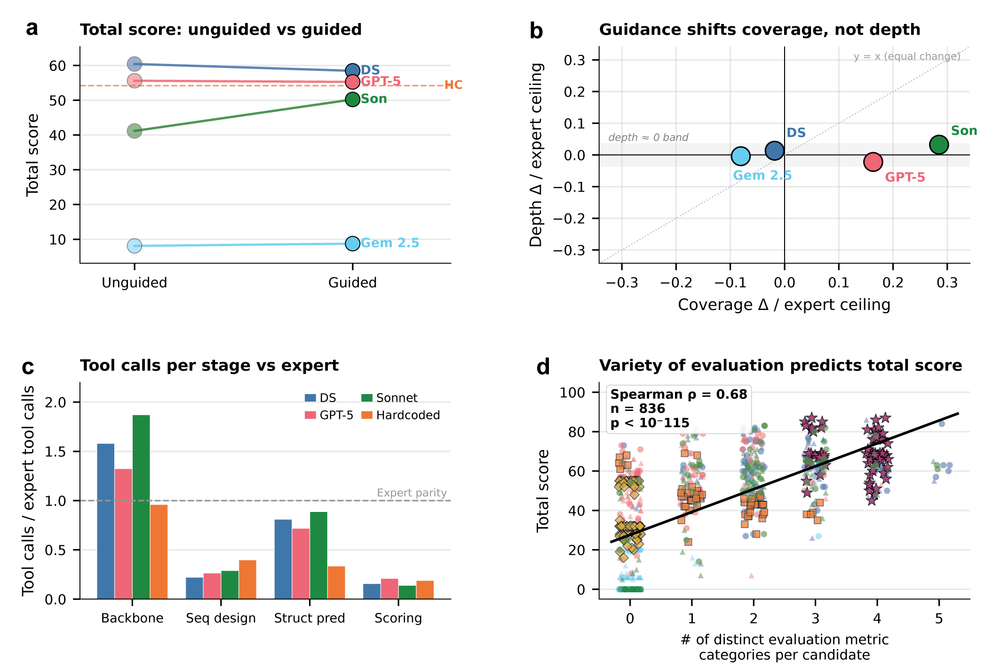

---
{
  "title": "BioDesignBench: a benchmark that helps improve the agent",
  "slug": "benchmarks-that-improve-agents",
  "category": "Paper notes",
  "summary": "Task design, MCP tools, and behavioral diagnosis form one research loop.",
  "paper": "biodesignbench",
  "draft": false
}
---

I built BioDesignBench because I wanted to understand how to improve protein design agents. A final score tells us whether a workflow produced a promising design. The decisions behind that score help explain what to change next.

## Make the scientific problem explicit

The study spans 76 tasks across five protein classes. I connected agents to 17 generation, prediction, and evaluation tools through MCP, so they could compose workflows rather than follow one fixed sequence of steps.

This makes both the candidate and the workflow objects of study. Did the agent generate useful alternatives? Which candidates did it evaluate? What evidence supported its final selection?

## Diagnose a decision, then test a change

A recurring weakness was shallow candidate evaluation. Having access to a tool did not guarantee that the agent used it thoroughly enough to compare its designs.

I used behavioral traces to make that failure concrete, then tested interventions encouraging deeper evaluation. The paired-task analysis follows the same tasks across conditions, connecting a proposed behavioral improvement to a measurable outcome. These were researcher-designed interventions; they provide an evaluation setting for studying feedback-driven agent improvement in Aim 3.

## Why this matters for the agent I want to build

I see a benchmark as part of an improvement loop: define the task, observe behavior, diagnose a failure, and evaluate the intervention. Better tools, context management, coordination, and learned policies can all be studied in this loop.

The next question is whether those improvements transfer to new protein tasks and survive experimental validation. A benchmark gain is a useful signal; a protein engineering campaign also needs evidence about measured function. I want the two forms of evaluation to inform one another.
