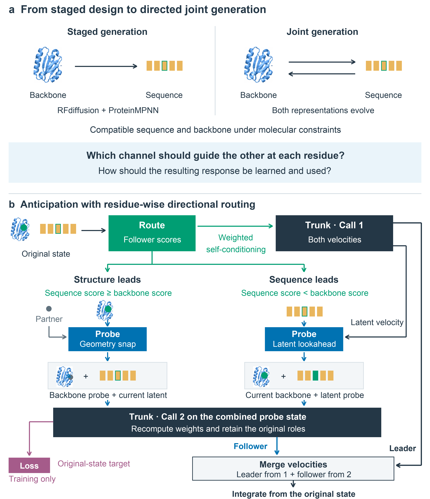

---
{
  "title": "Co-DIRECT: coordinate protein sequence and structure",
  "slug": "codirect-better-generation-tools",
  "category": "Paper notes",
  "summary": "Anticipation and residue-wise routing address harmful interactions in joint protein generation.",
  "paper": "codirect",
  "draft": false
}
---

A protein generator needs to produce a sequence and a structure that are compatible with one another. Updating both representations together offers a way to coordinate them, but their interaction can also introduce harmful local corrections. Co-DIRECT studies this modeling problem directly.

## More interaction is not automatically more useful

Joint protein generators allow a sequence prediction to influence a structural update and vice versa. A useful response should improve compatibility; a harmful response can propagate error from one representation to the other.

I developed anticipation with learned residue-wise directional routing to distinguish these cases. The method probes a tentative response and controls which representation leads and which receives the resulting correction.

The study evaluates binder design, enzyme scaffolding, and antibody CDR redesign. It compares generated and refolded designs under common candidate and evaluation budgets. The method does not require an external structure predictor during sampling.

## A model question with broader consequences

The central contribution concerns how coupled protein representations should interact during generation. Candidate quality and structural compatibility provide direct ways to evaluate those interactions.

Better joint generation also expands the candidates available to a design agent. Model development determines what can be proposed; agent research asks when to invoke generation, which evidence to request, and how to choose a next step.

## What I want to connect next

I want to study how biological constraints and experimental evidence can improve joint generation, especially when task-specific data are limited. In parallel, I want agents that compare candidates using complementary evidence and recognize when the generator or evaluation strategy needs to change. These are connected research questions within my longer-term AI-scientist vision.
