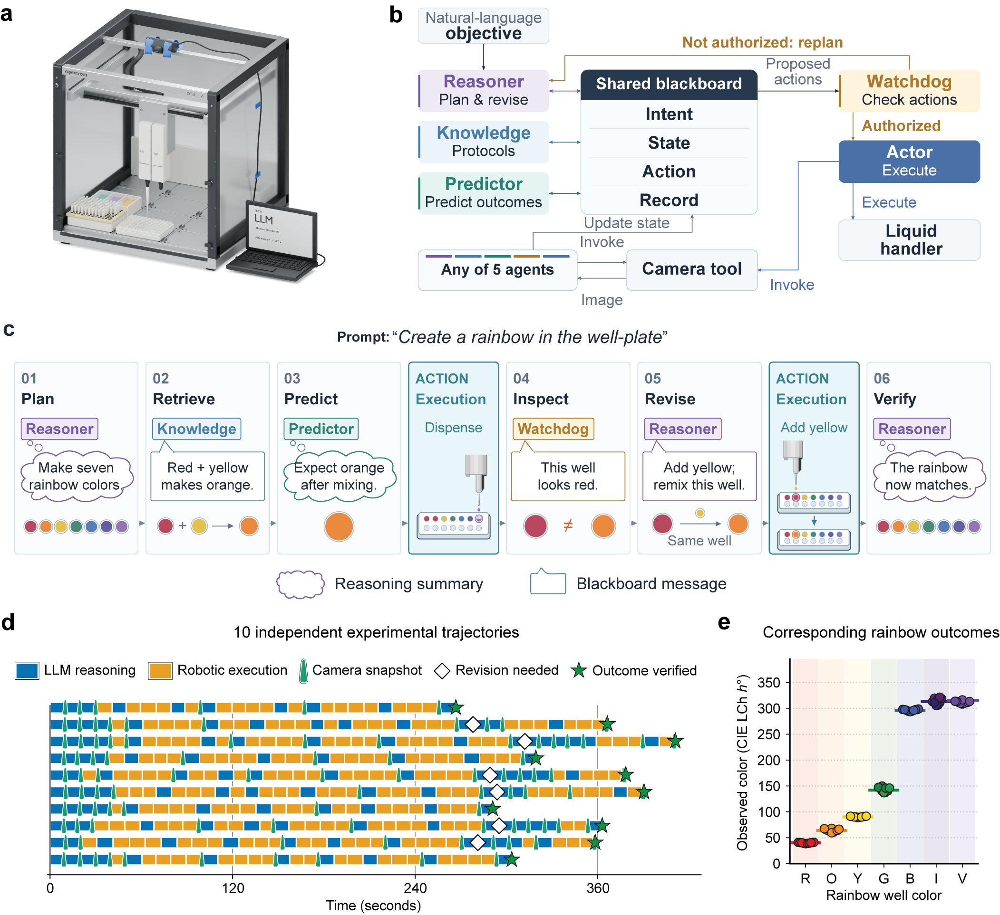
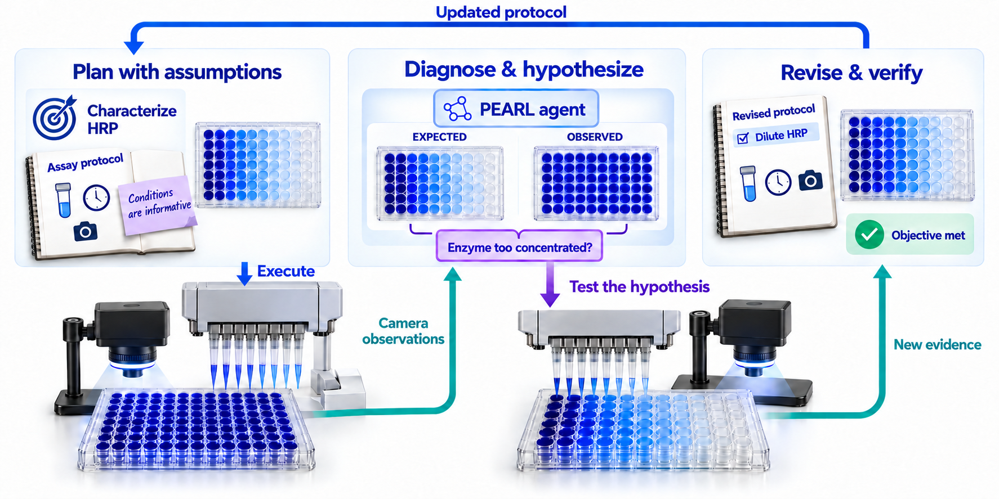

---
{
  "title": "PEARL: let the experiment change the plan",
  "slug": "learning-from-experiments",
  "category": "Paper notes",
  "summary": "Robotic experiments turn assumptions into questions an agent can test.",
  "paper": "pearl",
  "draft": false
}
---

An unexpected assay result should change the next decision. It may indicate a poor protein, an incorrect experimental assumption, or a measurement that cannot answer the question. Those possibilities call for different actions.

## Connect reasoning to physical evidence

In PEARL, I connected LLMs to a liquid-handling robot and camera. I developed persistent experimental context and organized five coordinated roles around a shared blackboard. Connecting the instruments, managing context, and orchestrating reasoning are separate parts of the system.

The agent receives an objective, plans an experiment, executes actions, and interprets observations. Eight evaluation scenarios examine ordinary execution and responses to problems.

## Test the assumption behind an uninformative assay

The initial protocol makes a working assumption: the selected assay conditions will provide informative measurements. In the HRP–TMB experiments, camera observations instead show a rapid, nearly uniform response. PEARL connects that mismatch to the possibility that the chosen enzyme concentration is too high.

The agent then designs and robotically performs dilution experiments to test that hypothesis. It inspects the new observations, establishes a usable working range, and revises the protocol for subsequent kinetic characterization. The reasoning is grounded in physical evidence, and the follow-up is generated without a supplied scenario-specific recovery recipe.

Other scenarios require different responses: retaining valid measurements after identifying an outlier, or repeating an experiment when early-time information is missing. The important behavior is choosing an action that addresses the cause of uncertainty.

## Bring experimental reasoning into protein design

I want this capability inside a larger protein design agent. Experimental feedback should help it decide whether to change the candidate, question a verifier, or investigate the assay.

PEARL demonstrates how an agent can revise a protocol within an experimental task. In Aim 3, I want to study how that experience can improve decisions in later campaigns. This requires records connecting observations, hypotheses, interventions, and outcomes, followed by an explicit test of whether the lesson transfers.
