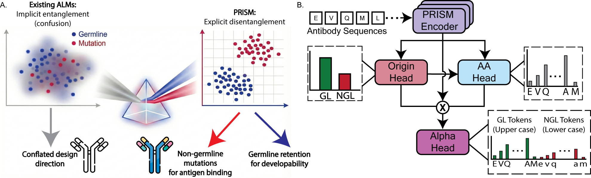

---
{
  "title": "PRISM: make functional mutations visible to the agent",
  "slug": "prism-functional-mutations",
  "category": "Paper notes",
  "summary": "A biased antibody score can misdirect generation, verification, and optimization.",
  "paper": "prism",
  "draft": false
}
---

A design agent often relies on a protein language model to judge whether a mutation is promising. That judgment depends on what the model has learned to reward.

## Separate conservation from functional variation

Antibody sequences contain germline-derived residues and non-germline changes introduced during maturation. Treating them as one statistical distribution can bias a model against rare mutations that matter for binding.

In PRISM, we explicitly separate residue origin and amino-acid identity. An origin-conditioned language-model head makes germline and non-germline representations available for scoring and controlled generation. My work focused on developing and testing the solution to this modeling problem.

## Give the agent a more informative tool

For an agent, the distinction changes how a score can be interpreted. A candidate can be unusual relative to germline sequence statistics while containing useful functional mutations. An agent that treats one likelihood as a complete measure of quality may overlook that distinction.

PRISM can support candidate scoring and generation, and its outputs can become components of an optimization objective. I see these as ways to improve the evidence beneath an agent's decisions. The downstream objective still needs validation for the specific function and setting.

## Develop evidence-guided agent decisions

I want agents to understand why they are using a scorer and what it can resolve. Binding, stability, solubility, and immunogenicity involve different evidence. I develop the agent’s evaluation capability through better scoring models and workflows that combine their outputs with complementary evidence.
