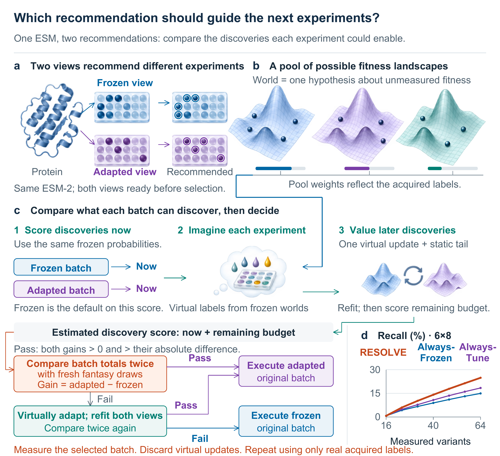

---
{
  "title": "RESOLVE: choose models through the experiments they recommend",
  "slug": "resolve-models-and-experiments",
  "category": "Paper notes",
  "summary": "Model adaptation and experimental selection belong to the same decision problem.",
  "paper": "resolve",
  "draft": false
}
---

When two models recommend different protein variants, which recommendation should guide the next experiment? Better fit to the labels already collected does not, by itself, answer that question.

## Value the recommendation

RESOLVE studies frozen and adapted views of one pretrained protein model. Each proposes experiments. The controller compares what those experiments may discover immediately and how their outcomes could improve later choices.

The evaluation accounts for hypothetical predictor and representation updates. Only real observations are retained between experimental rounds. The work combines this controller with local analysis of selection quality and retrospective comparisons across protein assays and feedback schedules.

## A concrete decision method for an agent

The connection to an agent is the choice itself. An agent should not switch to an adapted model simply because it is newer or more confident. It needs a reason to expect that the proposed experiments will make better use of the remaining budget.

This also links model development to experimental planning. A measurement changes the evidence available for the next model update, and that update changes which future experiments appear valuable.

## The larger workflow I want to build

I want agents to reason explicitly about competing recommendations and the information needed to choose between them. RESOLVE provides a focused setting for this question, using frozen and adapted recommendations from a shared backbone.

Extending that idea to more tools and richer biological feedback is a research direction. The central objective remains practical: use limited experiments to improve both the current protein campaign and the decisions that follow.
