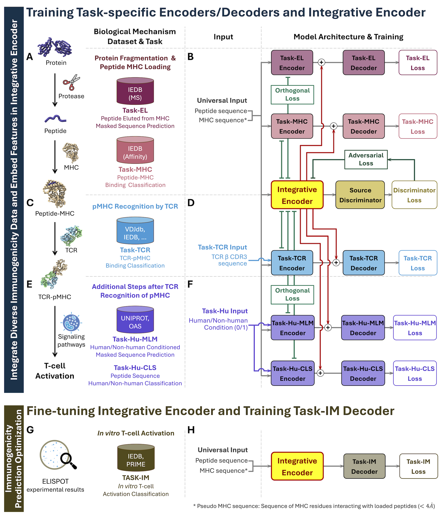

---
{
  "title": "T-SCAPE: learn immunogenicity from limited labels",
  "slug": "tscape-immunogenicity-verifier",
  "category": "Paper notes",
  "summary": "Multitask pretraining and domain adaptation connect related immune datasets to immunogenicity prediction.",
  "paper": "tscape",
  "draft": false
}
---

Predicting immunogenicity is difficult when direct experimental labels are scarce. Related immune datasets contain useful information, but differences between tasks and domains can prevent a model from transferring that information effectively. T-SCAPE addresses this learning problem.

## Learn from related immunological evidence

I developed shared and task-specific encoders with multitask pretraining and adversarial domain adaptation, followed by immunogenicity-specific fine-tuning. The aim is to learn transferable features while retaining information specific to each task.

The study evaluates peptide–MHC immunogenicity and antibody-level antidrug-antibody risk. Its modeling contribution is to make better use of heterogeneous evidence when the target labels are limited.

## Biological prediction as a research objective

The central question is how a model can learn a biological property from incomplete and unevenly distributed data, and whether the resulting representations transfer to the target task.

In a protein design system, such a predictor can also supply a criterion alongside function and structural evidence. Its role as a scoring component is one application of the model. A predicted immunogenicity score does not establish clinical safety, and its biological context remains important.

## What I want to connect next

I want to investigate how biological knowledge and new measurements can improve prediction under limited data. For scientific agents, a complementary question is when to rely on such predictions and when to seek additional evidence. Connecting advances in modeling to better experimental decisions is part of my AI-scientist vision.
